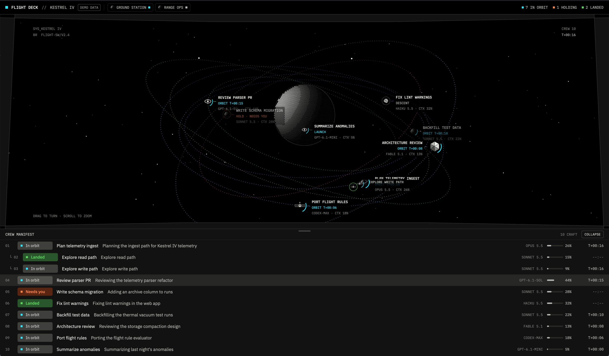

# Flight Deck

A cockpit view of your agents as a star system. The shown space is a dithered planet; each agent is a craft that launches from a pad when it starts work, orbits while it works, holds with a pulsing ring when it needs you, and lands when it's done. How full an agent's context is sets how close it orbits, and its model sets its shape and size. A crew manifest under the view lists every agent. Drag to turn the system, scroll to zoom.

## What you see

One view, dark and flat, on its own colours rather than the Herdr theme: `#000000` ground, `#121212` surfaces, `#222222` hairlines, `#edefea` text, `#b3b5b0` muted, `#7b7c79` faint, and one accent, a HUD cyan, `#2ee6ff`. Type is IBM Plex Mono for labels (caps) and IBM Plex Sans for body text, from the mod's `fonts/` folder. Top to bottom:

- **Top bar**, 40px, 1px `#222222` rule under it: an 8px cyan square, `FLIGHT DECK` in Mono 12 semibold, `//`, the system (space) name in caps; `DEMO DATA` in an outlined 20px chip in demo mode; a chip per other space (moon glyph, name, status square), and `RETURN` in cyan when you're viewing another space. On the right, `N IN ORBIT` (cyan square), `N HOLDING` (`#ff844d`), `N LANDED` (`#5bd65f`) in Mono 11.
- **The cockpit**, the rest of the height above the manifest, black:
  - A static starfield (`stars.svg`, 340 dots in four grays), centred and square.
  - **Canopy**: a top bow, two side pillars and a bottom lip in `#121212` with `#353534` edges, from `PathBuilder` polygons sized to the view.
  - **The planet** (`globe.svg`): a halftone globe of dots lit from the upper left, ceramic white fading to gray, with a faint night side and a hairline limb. Its size follows the camera.
  - **Orbits**: one dotted ring per craft (1.5px, dots `[1.5, 5]`), each in its own hue: `#8cabff`, `#58d6b5`, `#f257a5`, `#b061ff`, `#d9c27a`, `#c0c4ff`. No cyan, so a ring never looks like the accent. The half in front of the planet is 55% opacity, the half behind 30%, and the far half is drawn before the planet so the planet covers it.
  - **Craft**: a model glyph inside a status ring, with a tag to the right (left when the craft is in the right 30% of the view) on a `#000000cc` plate: the name in Mono 10.5 semibold caps, a status line (`LAUNCH`, `ORBIT T+04:12`, `HOLD · NEEDS YOU`, `DESCENT`, `LANDED`, `DOCKED`), and `MODEL · CTX 34%` in faint Mono 9.5. A short leader in the orbit's hue joins glyph and tag.
  - **Readouts** in the corners in faint Mono 10: `SYS <name>` and `BR <branch>` top left, `CREW <n>` and the longest working time top right, `DRAG TO TURN · SCROLL TO ZOOM` and `RESET VIEW` (after you move the view) bottom left.
- **Crew manifest**, `#121212`, by default between 112px and 36% of the height: a 32px header with a 36×3px grip centred at its top, `CREW MANIFEST`, `N CRAFT` and an outlined `COLLAPSE` / `EXPAND` button, then a 34px row per agent: number (sub-agents indented with `└`), a status badge (24px, radius 4, square mark plus `In orbit` / `Needs you` / `Landed` / `Docked` in Sans 12 semibold on a soft fill), the tab name, the terminal title (muted, truncated), the model in caps, a 48px context meter with its percentage, and `T+mm:ss` while working.

## How it behaves

- **Status as flight.** Working: a cyan 90° arc spins round the craft (1400ms) while it orbits. Blocked: the craft stops where it is and a `#ff844d` ring pulses (opacity 0.25 to 1, 1400ms). Done: it flies down to its pad (3.2s, keeping height then dropping) and gets a `#5bd65f` ring. Idle: it sits on its pad with a gray ring, and its tag shows only on hover. Starting work again launches it from wherever it is (3.2s, climbing fast, then swinging onto its orbit). A craft that's already working when the view opens launches from its pad, one after another.
- **Context sets the orbit.** Radius goes from 4.4 planet radii at 0% context to 1.45 at 100%, gliding at most 0.18 radii a second. Orbit speed follows Kepler's third law (period ∝ r^1.5), so inner craft move faster. Context and model are read from the bottom 16 lines of each agent's screen with `hc read` every 5 seconds: the line with a meter, a percentage and a token count (`███░░ 31% 311k`), and a model name on that same line.
- **Model sets shape and size.** Fable: faceted crystal, 1.3×. Opus: ringed planet, 1.2×. Sonnet: dithered moon, 1×. Haiku: cratered asteroid, 0.75×. GPT and o-series: ring station, 1.1×. Codex: satellite, 1.05×. Gemini and anything unknown: probe, 1×. `mini`, `flash` and `lite` shrink to 0.82×, `nano` to 0.7×, and `pro` or `max` add 0.12×. Until a model is read, the agent program decides (Claude: moon, Codex: satellite, else probe).
- **Room for every craft.** Each slot has its own tilt and line of nodes and a golden-angle start position. Radii are spread so no two orbits are closer than 0.24 planet radii. A tilt that would look edge-on from the default view is flipped, so every orbit reads as an ellipse.
- **Sub-agents** (a terminal whose `parent` is an agent in the same space) circle their parent on a small fast orbit and dock beside it when done.
- **Depth.** Craft scale with distance (closer is bigger) and fade to 55% behind the planet; behind the planet's disc they fade out.
- **Drag** turns the system (sideways spins it, up and down tilts it, from below the plane to straight down). **Scroll** zooms 0.45× to 2.6×. A press that moves more than 4px is a drag, not a click. The view is saved per copy.
- **The manifest resizes.** Drag its header up for taller, down for shorter (the cursor is a row resize). Dropped below 64px it collapses to its header; dragged back up it opens again. It keeps at least one row open and leaves the cockpit 120px. `COLLAPSE` / `EXPAND` toggles it. Height and state are saved per copy, and the camera refits as the cockpit changes size.
- **Click** a craft or a manifest row to focus that agent (`agent.focus`). Hovering either lights the other.
- **Other spaces**: click a chip to view that space's system; `RETURN` follows the shown space again.
- **Motion** is native: each craft glides between targets set every 0.7s while orbiting and every 0.22s while launching or landing (linear `transition` on left, top, width, height and opacity). With nothing moving, there are no redraws.
- **Props**, all optional: `demo: true` flies a scripted 72-second fleet instead of real agents (no terminals read, no agents started, clicks do nothing, `DEMO DATA` shows); `demoStart` skips into that script (seconds); `fps` redraws that often while craft move; `speed` (0 to 1) slows every motion and timer, for recording slowly and playing back faster.

## Built from

- **One mod**, `mods/flightdeck/`, no layout. `mod.json`: `{ "place": "none", "size": 720, "title": "Flight Deck" }`. Open it with `pane.split {direction: "right", mod: "flightdeck"}`, or as a tab with `tab.new {name: "Flight Deck", mod: "flightdeck"}`; the demo with `props: {demo: true}`.
- `main.js`: the view (`gpui-kit` `View`, `div`, `svg`, `image`, `PathBuilder`, `window.paint_path`; `gpui-base` `h_flex`, `v_flex`). Two `cx.spawn` loops: the flight tick, and the status-line reader (or the demo clock).
- `orbit.js`: pure 3D: orbits, pads, ascent and descent paths (slerp), radius spreading, the camera (yaw, pitch, zoom, perspective) and projection.
- `telemetry.js`: pure: `parseStatusLine` and `modelLook`.
- `demo.js`: the scripted fleet, standing in for `spaces()`, `agents()`, `terminals()`, `focused()` and the readings.
- **Herdr functions**: `agents`, `spaces`, `terminals`, `focused`, `props`, `settings`, `hc`, `run`, `setAgentOrder`. **Command**: `agent.focus`.
- **Programs**: `hc read <terminal> --lines 16`, every 5 seconds, for each agent in the shown space. No network. No files read or written.
- **Art**: `globe.svg`, `moon.svg`, `ringed.svg`, `crystal.svg`, `asteroid.svg`, `station.svg`, `sat.svg`, `probe.svg`, `arc.svg`, `ring.svg`, `stars.svg`. **Fonts**: IBM Plex Mono and Sans (Regular, Medium, SemiBold) with their licence.

## Watch out

- **Zoom.** `on_size_change` reports unzoomed pixels while every length you set is zoomed: divide the size by `settings().zoom`, or the view overflows its block.
- **Orbits need a timer.** Native motion only swings or glides `left`, `top`, `width`, `height` and `opacity`, so a tilted orbit is a series of targets with linear transitions. Aim each target one tick ahead, and integrate the angle step by step, since speed changes with radius.
- **Resizing.** Follow the drag on the root, not the header, so it continues when the pointer leaves the header; pointer positions are unzoomed, like sizes, so divide them by the zoom too. Stop the press on the `COLLAPSE` button so a click there never starts a resize.
- **Dashed paths.** Build one `PathBuilder` per dotted run: a dashed path draws across a `move_to`.
- **Fonts** in `fonts/` load at start or on the next look change; change zoom once after installing.
- **Model and context come from the screen.** Herdr doesn't report them. An agent whose status line shows neither stays on the far orbit with its program's glyph and `MODEL --`, `CTX --`. A dialog over the status line keeps the last reading.
- **Recording.** `herdr-app shot` takes about 170ms for a 5K frame; several at once can freeze Herdr. Capture one at a time, and use `speed` to slow the view down rather than capturing faster.
- Herdr draws only while its window is visible: captures of a covered window repeat one frame.

## Done when

- `herdr-app check ~/.config/herdr-app/mods/flightdeck` passes.
- Opening it beside a working agent shows that agent's craft orbiting with a spinning cyan arc, its model and context on the tag, and a matching manifest row.
- An agent that finishes flies down to its pad and its badge turns green `Landed`; starting it again launches it.
- A blocked agent stops and pulses `#ff844d`, and the top bar counts it as `HOLDING`.
- As an agent's context fills, its orbit moves closer to the planet.
- Two agents on the same model and context get two visibly separate orbits.
- Dragging turns the system, scrolling zooms, and `RESET VIEW` puts it back.
- Dragging the manifest's header resizes it; dragging it to the bottom collapses it to the header, and `EXPAND` opens it.
- `props: {demo: true}` shows `DEMO DATA` and the scripted fleet without reading any terminal.
