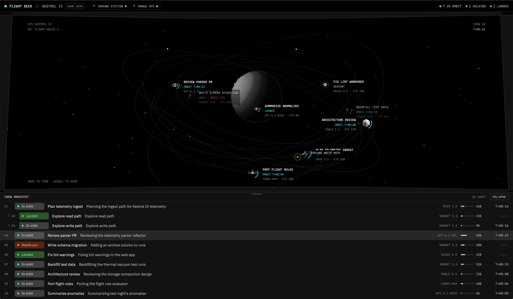

# Flight Deck

A cockpit view of your agents as a fleet of star systems. Every space is its own halftone planet, each with its own colors, surface, shape and size, laid out on a grid that fits the view (Fleet mode), or just the shown space (System mode). Each agent is a craft that launches from a pad when it starts work, orbits while it works, holds with a pulsing ring when it needs you, and lands when it's done. How full an agent's context is sets how close it orbits, its model sets its shape and size, and its git worktree sets the color of its branch label and leader. A crew manifest under the view lists every agent. Drag to turn the system, scroll to zoom.

## What you see

One view, dark and flat, on its own colours rather than the Herdr theme: `#000000` ground, `#121212` surfaces, `#222222` hairlines, `#edefea` text, `#b3b5b0` muted, `#7b7c79` faint, and one accent, a HUD cyan, `#2ee6ff`. Type is IBM Plex Mono for labels (caps) and IBM Plex Sans for body text, from the mod's `fonts/` folder. Top to bottom:

- **Top bar**, 40px, 1px `#222222` rule under it: an 8px cyan square, `FLIGHT DECK` in Mono 12 semibold, `//`, then `FLEET · N SYSTEMS` in Fleet mode or the system (space) name in caps in System mode; `DEMO DATA` in an outlined 20px chip in demo mode. In System mode, from 820px wide, a chip per other space (space color square, name, status square), and `RETURN` in cyan when you're viewing another space. On the right, `N IN ORBIT` (cyan square), `N HOLDING` (`#ff844d`), `N LANDED` (`#5bd65f`) in Mono 11 (numbers only under 620px), and an outlined `FLEET` / `SYSTEM` toggle.
- **The cockpit**, the rest of the height above the manifest, black and open to the block's edges (no frame drawn in the mod; the layout's 1px rounded border is the only edge):
  - A static starfield (`stars.svg`, 340 dots in four grays), centred and square.
  - **The planets** (`planets/*.svg`, drawn by `planets/make.py`): halftone worlds of dots on a hex grid (8px across, 7px down, on a 400px disc), lit from the upper left, with a dim night side, a disc in a dark shade of the planet's color and a hairline limb. Each dot's size follows the light; its color comes from a texture on the sphere. Ten worlds, with their radius against the orbits' unit planet: `jovian` (tan and cream bands with a red storm, squashed 0.92, 1.15), `terran` (blue seas, green and tan land, white caps, 0.9), `cinder` (dark crust with glowing orange fissures, 0.72), `glacier` (pale blue ice with dark fractures and white poles, 0.82), `saturnine` (lavender bands with three gold rings, 0.95), `dust` (rust dunes with a pale cap, 0.8), `toxic` (yellow-green swirls, 1.02), `rock` (a lumpy gray body covered in craters, 0.66), `neptune` (deep blue bands with a dark storm and two faint rings, 1.05) and `magenta` (pink swirls, 0.88). A space's world comes from an FNV-1a hash of its name; a world already taken by another space (in id order) moves on to the next free one, so worlds repeat only past ten spaces. Docked craft sit on pads at 1.08 times the world's radius, and craft hide behind its disc. Ringed worlds' art is wider than their disc (1.93× and 1.52×) and is drawn centred at that size. One per system, each centred in its grid cell; the grid picks the column count that gives each system the most room (a system is about 1.45 times as wide as tall) and centres a short last row, so a tall narrow deck stacks them. Each planet has an atmosphere ring in its space's color (`shared("space.colors")`, the sidebar avatar's color), 2px at 80% for the shown space, 1px at 33% for the rest. With several systems, the shown one gets four thin cyan corner brackets, and every planet has a tag under it: color square, name in caps, crew count, and a square for its most urgent status.
  - **Orbits**: one dotted ring per craft (1.5px, 1.2px with several systems, dots `[1.5, 5]`), in muted gray `#b3b5b0` so the rings stay quiet behind the craft. Only craft in flight draw one: launching, orbiting or holding. A descending, landed or docked craft has no ring. The half in front of the planet is 55% opacity, the half behind 30%, and the far half is drawn before the planet so the planet covers it.
  - **Craft**: a model glyph inside a status ring, with a tag to the right (left when the craft is in the right 30% of the view) on a `#000000cc` plate: the name in Mono 10.5 semibold caps, a status line (`LAUNCH`, `ORBIT T+04:12`, `HOLD · NEEDS YOU`, `DESCENT`, `LANDED`, `DOCKED`), `⎇ <branch>` in the worktree's color from `shared("deck.tree")` (published by the layout's sidebar), so craft in one branch share a hue, and `MODEL · CTX 34%` in faint Mono 9.5. With several systems, the branch and model lines show only on hover or focus and names cut at 18 characters. A short leader in the same hue joins glyph and tag. Without worktree data, each slot takes its own hue: `#8cabff`, `#58d6b5`, `#f257a5`, `#b061ff`, `#d9c27a`, `#c0c4ff`. No cyan, so a label never looks like the accent. The name is Pi's session name (from its title, `π - <name> - <folder>`), else a named tab, else the terminal title, else the program.
  - **Readouts** in the corners in faint Mono 10, 16px from the edges (the top bar's padding): `SYSTEMS <n>` and `WORKTREES <n>` top left (one system: `SYS <name>` and `WT <n>`), `CREW <n>` and the longest working time top right, `DRAG TO TURN · SCROLL TO ZOOM` (plus `· DOUBLE-CLICK A PLANET` with several systems; hidden under 480px) and `RESET VIEW` (after you move the view) bottom left.
- **Crew manifest**, `#121212`, by default exactly as tall as its crew (a 1px top rule, the 32px header, then every row, or a 41px empty note), never leaving the cockpit less than 120px: a 32px header with a 36×3px grip centred at its top, `CREW MANIFEST`, `N CRAFT` and an outlined `COLLAPSE` / `EXPAND` button. Rows are grouped: a 24px header per system when there are several (space color square, name, craft count; click to show that space), a 24px header per worktree (color dot, branch in its color, `MAIN` for the main checkout), then a 34px row per agent: number (sub-agents indented with `└`), a status badge (24px, radius 4, square mark plus `In orbit` / `Needs you` / `Landed` / `Docked` in Sans 12 semibold on a soft fill), the agent's name, the model in caps (from 560px wide), a 48px context meter with its percentage, and `T+mm:ss` while working.

## How it behaves

- **Status as flight.** Working: a ring in its space's color circles the craft while it orbits (the planet label's square), and its `LAUNCH` and `ORBIT T+…` status line takes that color too, so a craft reads as its system's. Blocked: the craft stops where it is inside a `#ff844d` ring. Rings hold still: a `spin` or `loop` redraws the whole window on its own clock, which delays terminal echo while you type. Done: it flies down to its pad (3.2s, keeping height then dropping) and gets a `#5bd65f` ring. Idle: it sits on its pad with a gray ring, and its tag shows only on hover. Starting work again launches it from wherever it is (3.2s, climbing fast, then swinging onto its orbit). A craft that's already working when the view opens launches from its pad, one after another.
- **Context sets the orbit.** Radius goes from 4.4 planet radii at 0% context to 1.45 at 100%, gliding at most 0.18 radii a second. Orbit speed follows Kepler's third law (period ∝ r^1.5), so inner craft move faster. Context and model are read from the bottom 16 lines of each agent's screen with `hc read` every 5 seconds: the line with a meter, a percentage and a token count (`███░░ 31% 311k`), and a model name on that same line. A herdr-chat agent (label `herdr-chat.chat`, argv running `herdr-chat-host` or `herdr-chat-subagent`) shows a transcript instead, so Flight Deck asks its host: model from `state.model` (the id, or the name when the id is an alias such as `opus`, shortened like the status line to `opus 5.5`), context from `state.usage.percent`.
- **Model sets shape and size.** Fable: faceted crystal, 1.3×. Opus: ringed planet, 1.2×. Sonnet: dithered moon, 1×. Haiku: cratered asteroid, 0.75×. GPT and o-series: ring station, 1.1×. Codex: satellite, 1.05×. Gemini and anything unknown: probe, 1×. `mini`, `flash` and `lite` shrink to 0.82×, `nano` to 0.7×, and `pro` or `max` add 0.12×. Until a model is read, the agent program decides (Claude: moon, Codex: satellite, else probe).
- **Room for every craft.** Each slot has its own tilt and line of nodes and a golden-angle start position. Radii are spread so no two orbits are closer than 0.24 planet radii. A tilt that would look edge-on from the default view is flipped, so every orbit reads as an ellipse.
- **Sub-agents** (a terminal whose `parent` is an agent in the same space) circle their parent as moons while it is in flight, each on its own dotted ring that rides along with the parent (gray, 50% on the side nearer the camera than the parent, 20% behind, 1.2px, dots 1.5 on 4). Rings come in four radii, 0.6 to 1.14 planet radii, each slot with its own tilt (28, -18, 40, -8, 22, -34°, flipped when it would look edge-on) and line of nodes (53° apart). A turn takes 7s on the inner ring to about 12.5s on the outer. With the parent docked, a working or blocked sub-agent uses a planet-centered dotted track instead, spaced with the other planet orbits and sized by its own context. It keeps its satellite glyph and switches back to a moon track as the parent launches. When a sub-agent finishes it flies down beside its parent and then leaves the view; only full agents keep a docked marker on the planet. The manifest still lists every sub-agent.
- **Depth.** Craft scale with distance (closer is bigger) and fade to 55% behind the planet; behind the planet's disc they fade out.
- **Drag** turns the system (sideways spins it, up and down tilts it, from below the plane to straight down). **Scroll** zooms 0.45× to 2.6×. A press that moves more than 4px is a drag, not a click. The view is saved per copy.
- **The manifest resizes.** Drag its header up for taller, down for shorter (the cursor is a row resize). Dropped below 64px it collapses to its header; dragged back up it opens again. Dragged open, it keeps at least one row and leaves the cockpit 120px. `COLLAPSE` / `EXPAND` toggles it. A dragged height lasts until the panel is resized, the view is reopened, or `EXPAND` is pressed; then it snaps back to fit the crew, and it follows the crew as agents come and go. Collapsed or open is saved per copy. The camera refits whenever the cockpit changes size, including when the crew changes the manifest's height.
- **Click** a craft, its tag or a manifest row to focus that agent (`agent.focus`). Hovering either lights the other. A craft's hover target is its glyph plus an 8px halo all round, and its tag while the tag shows, so the pointer can move from glyph to tag without the tag closing. A docked craft's hidden tag isn't a target, so its spot on the planet doesn't open tags you can't see.
- **Fleet and System.** `FLEET` (the default, saved per copy) shows every space; `SYSTEM` shows one, following the shown space. Click a planet or its tag to show that space; double-click a planet to open it in System mode. In System mode, click a chip to view another space's system; `RETURN` follows the shown space again. Drag and scroll turn and zoom every system together.
- **Motion** runs at 30fps: while any shown craft launches, orbits or lands, a 33ms tick places every craft where it is now and redraws only `CraftLayer`, a retained child view holding the craft and moon rings. The rest of the view (stars, planets, orbits, HUD, manifest) redraws once a second for its clocks, or when something changes. Don't move craft with native `transition` glides: they run at the display's refresh rate (144Hz on a 5K monitor) and Herdr redraws the whole window for each frame (herdr-app#413), which kept the main thread about 70% busy and made typing into Claude Code or Codex lag. Transitions remain only for one-off moves (300ms when the crew changes, 400ms on reset view) while nothing is in flight. With nothing moving, there are no redraws.
- **Props**, all optional: `demo: true` flies a scripted 72-second fleet instead of real agents (no terminals read, no agents started, clicks do nothing, `DEMO DATA` shows); `demoStart` skips into that script (seconds); `fps` sets the motion tick instead of 30fps (at least 33ms); `speed` (0 to 1) slows every motion and timer, for recording slowly and playing back faster.

## Built from

- **One mod**, `mods/flightdeck/`, no layout. `mod.json`: `{ "place": "none", "size": 720, "title": "Flight Deck" }`. Open it with `pane.split {direction: "right", mod: "flightdeck"}`, or as a tab with `tab.new {name: "Flight Deck", mod: "flightdeck"}`; the demo with `props: {demo: true}`.
- `main.js`: the view (`gpui-kit` `View`, `div`, `svg`, `image`, `PathBuilder`, `window.paint_path`; `gpui-base` `h_flex`, `v_flex`). `CraftLayer`, the craft layer, made with `cx.new` in `init` and mounted in the cockpit; the flight tick rebuilds it with `layer.set_props({ deck, tick })`, and the whole view with `cx.notify()`. Never wake the flight tick from `render` (or from anything `render` calls, like `sync`): a layer redraw requested while the view's render is settling gets dropped, and the craft then freeze until the next full render, about a second. With nothing moving the tick polls every 250ms instead, so it picks up what `render` marked dirty. Two `cx.spawn` loops: the flight tick, and the status-line reader (or the demo clock). The reader also keeps the chat links open.
- `orbit.js`: pure 3D: orbits, pads, ascent and descent paths (slerp), radius spreading, the camera (yaw, pitch, zoom, perspective) and projection.
- `telemetry.js`: pure: `parseStatusLine`, `chatModel` and `modelLook`.
- `chats.js`: `ChatTelemetry`, one WebSocket link per shown herdr-chat agent. It reads the host's registry `<appHome>/data/herdr-chat/chats/<chat>.json` for `wsPort` and `token`, sends `{t: "hello", v: 1, token, client: "flightdeck"}`, answers every message with `{"t":"ack"}` (the host sends at most 4 before one), and keeps `model` and `usage` from the `snapshot` record and later `patch` records' `state`. A link that drops is forgotten and reopened on the next read; links for agents no longer shown close.
- `demo.js`: the scripted fleet, standing in for `spaces()`, `agents()`, `terminals()`, `focused()` and the readings.
- **Herdr functions**: `agents`, `spaces`, `terminals`, `panes`, `focused`, `props`, `settings`, `shared`, `hc`, `run`. **Commands**: `agent.focus`, `space.select`. It doesn't set the agent order: the sidebar does.
- **Shared state it reads**: `deck.tree` (`{ panes: {pane: worktree path}, worktrees: {path: {branch, main, color, space}}, spaces: {id: [paths]} }`) and `space.colors`. Both are written by the layout's `deck-spaces` sidebar; without them it falls back to per-slot hues and gray atmospheres.
- **Programs**: `hc read <terminal> --lines 16`, every 5 seconds, for each non-chat agent in the systems shown.
- **Network and files**: a WebSocket to `127.0.0.1:<wsPort>` per shown chat agent, and that chat's registry file, read only. Nothing written.
- **Art**: `planets/*.svg` (ten worlds, rebuilt by `python3 planets/make.py`), `moon.svg`, `ringed.svg`, `crystal.svg`, `asteroid.svg`, `station.svg`, `sat.svg`, `probe.svg`, `arc.svg`, `ring.svg`, `stars.svg`. **Fonts**: IBM Plex Mono and Sans (Regular, Medium, SemiBold) with their licence.

## Watch out

- **Zoom.** `on_size_change` reports unzoomed pixels while every length you set is zoomed: divide the size by `settings().zoom`, or the view overflows its block.
- **Orbits need a timer.** Native motion only swings or glides `left`, `top`, `width`, `height` and `opacity`, and glides run at the display's rate, so a tilted orbit is a 30fps tick that places each craft at the current time. Integrate the angle step by step, since speed changes with radius. Redraw only the craft layer per tick: a full render of the view costs about 20ms, and 10fps of full renders looked choppy and cost nearly as much as the glides.
- **Resizing.** Follow the drag on the root, not the header, so it continues when the pointer leaves the header; pointer positions are unzoomed, like sizes, so divide them by the zoom too. Stop the press on the `COLLAPSE` button so a click there never starts a resize.
- **Dashed paths.** Build one `PathBuilder` per dotted run: a dashed path draws across a `move_to`.
- **Paneless sub-agents.** `agents()` can omit them even while they report a status. Follow live parent links from `terminals()`, add missing status-reporting descendants to the crew without duplicating listed agents, and inherit the nearest listed or added ancestor's space and tab. Shells with no status aren't craft.
- **One camera per system.** Build each with `camera(cell.w, cell.h, look)` and shift its centre by the cell's origin; project each craft with its own space's camera, and key the orbit cache on the cells too.
- **Scaled SVG strokes.** An SVG drawn large scales its strokes; draw thin brackets as bordered divs instead.
- **Planet sizes.** The orbits treat the planet as radius 1. A world's size scales only its art, its pads and its hide test; keep sizes under about 1.2 so the nearest orbit (1.45, never under 1.25) stays clear of the surface.
- **Fonts** in `fonts/` load at start or on the next look change; change zoom once after installing.
- **Model and context come from the screen or the chat host.** Herdr doesn't report them. An agent whose status line shows neither stays on the far orbit with its program's glyph and `MODEL --`, `CTX --`. A dialog over the status line keeps the last reading. A chat agent's screen has no status line, so reading its screen leaves the tag at `MODEL --` for good: ask its host instead.
- **Hover across parts.** Leaving the halo and entering the tag can report in either order, so track each part under the pointer and drop the hover only when none is left; prune parts of craft that leave the view, since they never report leaving.
- **Chat links across reloads.** A mod reload leaves the old build's WebSockets open until QuickJS collects them; count builds on a `globalThis` symbol and close older builds' links when a new one starts.
- **Recording.** `herdr-app shot` takes about 170ms for a 5K frame; several at once can freeze Herdr. Capture one at a time, and use `speed` to slow the view down rather than capturing faster.
- Herdr draws only while its window is visible: captures of a covered window repeat one frame.

## Done when

- `herdr-app check ~/.config/herdr-app/mods/flightdeck` passes.
- With two spaces open, Fleet mode shows two planets, the shown one bracketed in cyan; clicking the other planet switches space, and double-clicking opens it in System mode.
- Spaces show different worlds: different colors, surfaces and sizes, some ringed. A space keeps its world after a reload.
- Every orbit is the same muted gray dotted ring, whatever its worktree.
- A craft's ring disappears when it starts its descent and stays hidden while it's landed or docked; it comes back when the craft launches again.
- With an idle parent and a working paneless sub-agent, the manifest lists the sub-agent and its satellite orbits the planet, not the dock. When the parent takes off, the satellite circles it; when the parent docks again, the satellite returns to its planet orbit.
- Two agents in different worktrees of one space show their branch labels in different colors, matching the sidebar's worktree dots.
- Opening it beside a working agent shows that agent's craft orbiting with a ring and `ORBIT` line in its planet label's color, its model and context on the tag, and a matching manifest row.
- An agent that finishes flies down to its pad and its badge turns green `Landed`; starting it again launches it.
- A blocked agent stops inside a `#ff844d` ring, and the top bar counts it as `HOLDING`.
- As an agent's context fills, its orbit moves closer to the planet.
- Two agents on the same model and context get two visibly separate orbits.
- Hovering just outside a small craft opens its tag, and moving onto the tag keeps it open.
- Dragging turns the system, scrolling zooms, and `RESET VIEW` puts it back.
- Opened, and after resizing the panel, the manifest shows every crew row with no empty space under the last one.
- Dragging the manifest's header resizes it; dragging it to the bottom collapses it to the header, and `EXPAND` opens it.
- `props: {demo: true}` shows `DEMO DATA` and the scripted fleet without reading any terminal.
